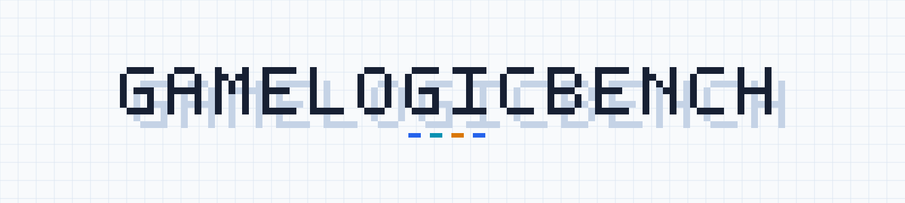

<p align="center">
  <picture>
    <source media="(prefers-color-scheme: dark)" srcset="assets/banner-dark.svg">
    
  </picture>
</p>

<h3 align="center">Evaluating Coding Agents on Runtime Game Logic with Tick-Level State Assertions</h3>

<p align="center">
  <a href="https://arxiv.org/abs/2609.21562"></a>
  <a href="https://github.com/NJU-LINK/GameLogicBench"></a>
  <a href="docs/running.md"></a>
</p>
<p align="center">
  <a href="https://www.python.org/downloads/"></a>
  <a href="https://godotengine.org/"></a>
</p>

<p align="center">
  <a href="#quick-start">Quick Start</a> &bull;
  <a href="#why-gamelogicbench">Why GameLogicBench?</a> &bull;
  <a href="#benchmark-at-a-glance">Benchmark</a> &bull;
  <a href="#how-it-works">How It Works</a> &bull;
  <a href="#documentation">Documentation</a> &bull;
  <a href="#citation">Citation</a>
</p>

---

## Introduction

GameLogicBench evaluates coding agents on **runtime game logic**. An agent implements a gameplay
task inside a deterministic Godot project; an isolated evaluator then checks the game's observable
state at every simulation tick. The same solution is re-evaluated on new seeds, larger scales, and
held-out scenarios so that a passing final state is not enough — the solution must obey the rules
throughout execution.

The evaluator is fixed code rather than an LLM rubric. It never reads the submitted source or the
agent's self-report, and it produces reproducible verdicts from black-box behavioural assertions.

## Benchmark at a glance

| | |
|---|---|
| **72 gameplay-logic tasks** | From isolated mechanics to multi-system interactions and repository-scale features. |
| **403 hand-designed scenarios** | Public and hidden scenarios share the same disclosed rule family while exercising different difficulty axes. |
| **1,451 seeded test cases** | Every scenario expands into reproducible seed-level evaluations. |
| **Tick-level assertions** | Judges inspect collisions, arrivals, timeouts, routing, state transitions, and other observable quantities during the run. |
| **Implementation-agnostic** | Correct solutions may use different designs; mutation tests check that required capabilities are actually enforced. |
| **Agent-aware evaluation** | Solve containers can be network-restricted, making public-code copying an explicit, measurable condition. |

## Why GameLogicBench?

Many game-development benchmarks replay a fixed example, score a video, or ask another model to
judge the result. GameLogicBench targets a different failure mode: a game can end in a valid state
after violating its rules earlier in the simulation. Tick-level assertions expose those violations,
while seeded perturbations measure whether the implemented logic generalises beyond the preview case.

The benchmark separates the task library from the harness. The library contains game projects,
frozen judges, reference solutions, assets, and scenario specifications; the public repository
contains the runner, container isolation, agent scaffolds, result schema, and analysis scripts.

## Quick Start

### Installation

Clone the harness and its task library into the same directory:

```bash
git clone https://github.com/NJU-LINK/GameLogicBench.git
cd GameLogicBench
git clone https://github.com/NJU-LINK/GameLogicBench-Tasks.git tasks
```

Create an isolated Python environment and install the package with its development dependencies:

```bash
python -m venv .venv
source .venv/bin/activate
python -m pip install --upgrade pip
python -m pip install -e ".[dev]"
```

The judge and recording paths run in the `geb-all` Docker image. Provision the vendored Godot
binary and agent package described in [`docs/running.md`](docs/running.md), then build the image:

```bash
docker build -t geb-all .
docker run --rm geb-all godot --headless --version
```

### Run a reference solution

Run the deterministic `proper` reference on one task, then compute the score from the result tree:

```bash
python -m geb.cli command=judge task=atom_move_navigation solution=proper
python scripts/score.py --task atom_move_navigation
```

`naive` is provided as a calibration reference for tasks that include a known hidden failure mode:

```bash
python -m geb.cli command=judge task=atom_move_navigation solution=naive
```

### Run a coding agent

Add model endpoints to `conf/models/default.yaml` using the tracked template, then select a model
and scaffold. The full `run` command performs solve followed by judge:

```bash
cp conf/models/default.yaml.example conf/models/default.yaml
python -m geb.cli command=run task=atom_move_navigation solution=<model> scaffold=cc
```

For pass@k sampling, set `sample_num`; for several tasks, use a Hydra list or a quoted comma list:

```bash
python -m geb.cli command=run task=atom_move_navigation sample_num=3 solution=<model> scaffold=cc
python -m geb.cli command=solve 'task=[combo_reverse_dock,atom_keeper_arc]' solution=<model> scaffold=codex
```

## How It Works

| Phase | What happens | Output |
|---|---|---|
| **Solve** | An agent receives the runnable game project and writes its controller in a writable container. The frozen judge and hidden seeds stay outside that container. | A workspace and session status |
| **Judge** | The harness overlays `game → solution → judge`, runs one isolated container per seed, and checks observable state frame by frame with `--network=none`. | One `result.json` per scenario and seed |
| **Score** | The analysis scripts read the result tree on demand and compute public/hidden pass rates, pass@k, and the perturbation gap. | Printed matrices and leaderboards; no summary file is accumulated |
| **Record** | An optional Godot + Movie Maker path renders a judged trajectory as an MP4 for inspection. | `record/run.mp4` beside the cell result |

### Task levels

Tasks follow a small capability ladder:

| Prefix | Scope |
|---|---|
| `atom_` | One gameplay capability, such as navigation, collision handling, or state transitions |
| `combo_` | Several capabilities combined with single-axis hidden perturbations for attribution |
| `repo_` | A repository-scale feature where the agent modifies a real upstream project |

### Result layout

```text
result/
├── <solution>/<task>/test/<scenario>_<seed>/result.json
└── <solution>/<task>/sample_<i>/test/<scenario>_<seed>/result.json
```

Each cell records the task-library commit used for evaluation. Scores are computed from the files
currently present, so rerunning `scripts/score.py` always reflects the latest completed matrix.

## Task and information boundaries

The agent sees the runnable `game/` project and its public preview seed. The frozen `judge/`, hidden
seeds, and hidden scenario constructors are mounted only during evaluation. The overlay order puts
the judge last, so editing a frozen file cannot change the verdict. Repository-scale tasks can
explicitly declare deliverable paths when the agent is expected to implement an engine module.

The solve phase can use the `geb-egress` Docker network, which admits DNS and registered model
endpoints while blocking unrelated outbound connections. Judge and record remain fully offline.
The rationale and verification commands are documented in
[`docs/running.md`](docs/running.md#the-solve-egress-whitelist-geb-egress).

## Project structure

```text
geb/          # harness source: CLI, pipeline, Godot runner, containers, scaffolds
conf/         # Hydra configuration and the model registry template
tasks/        # separate task-library repository (gitignored here)
result/       # grading output (gitignored)
logs/         # resolved configurations and run logs (gitignored)
third_party/  # vendored Godot binary and agent package for the Docker image
tests/        # unit tests
scripts/      # score, cost, leaderboard, and pricing utilities
docs/         # running, structure, maintenance, and result-field guides
Dockerfile    # reproducible judge and recording image
```

## Documentation

| Document | Contents |
|---|---|
| [`docs/running.md`](docs/running.md) | Installation, Docker image, model registry, commands, and egress verification |
| [`docs/structure.md`](docs/structure.md) | Code organisation, overlay assembly, task boundaries, and solve → judge flow |
| [`docs/status-fields.md`](docs/status-fields.md) | Every field and enum in `status.json` and `result.json` |
| [`docs/maintenance.md`](docs/maintenance.md) | Development workflow and instructions for changing the harness |
| [`scripts/score.py`](scripts/score.py) | On-demand PASS/FAIL matrices and pass@k summaries |
| [`scripts/leaderboard.py`](scripts/leaderboard.py) | Model leaderboard by atom, combo, and repository-scale task level |

## Citation

If GameLogicBench supports your work, please cite:

```bibtex
@article{che2026gamelogicbench,
  title         = {GameLogicBench: Evaluating Coding Agents on Runtime Game Logic with Tick-Level State Assertions},
  author        = {Che, Xinyu and Ge, Yunfei and Li, Shihao and Liu, Yanchen and Yan, Hang and Lei, Xinping and Wang, Yanghai and Dong, Zixuan and Yao, Yifan and Xie, Qianqian and Zhu, Letian and Liu, Jiaheng},
  journal       = {arXiv preprint arXiv:2609.21562},
  year          = {2026},
  url           = {https://arxiv.org/abs/2609.21562},
}
```
